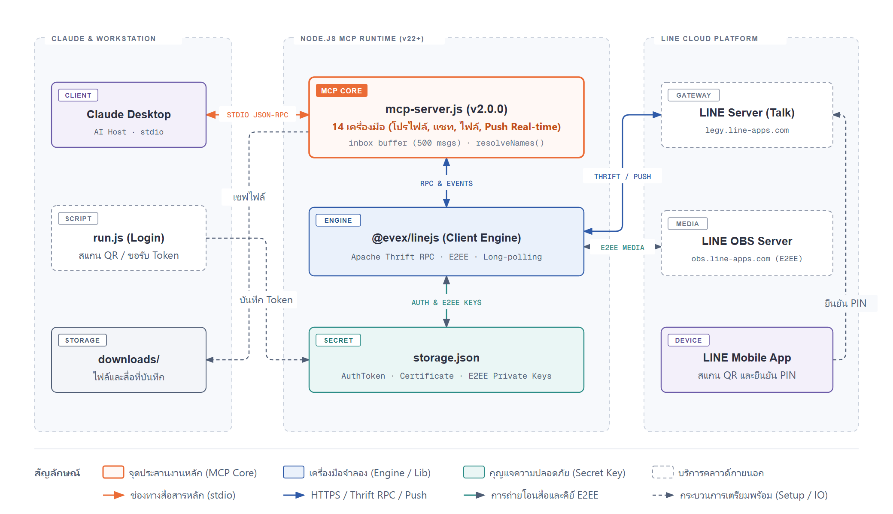
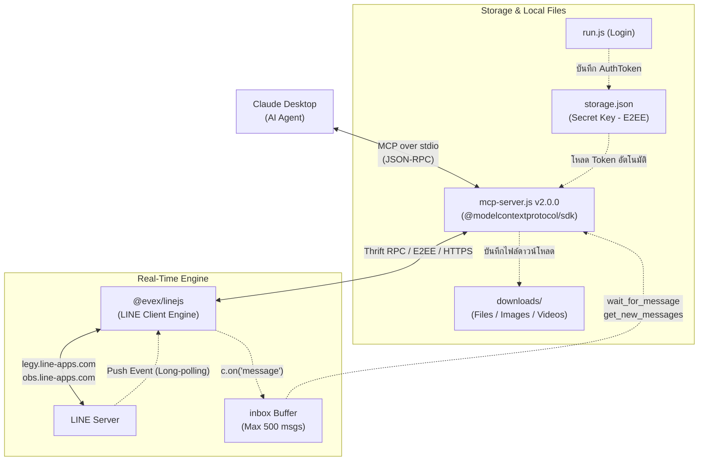

# line-selfbot-mcp

[](package.json)
[](https://nodejs.org/)
[](https://github.com/modelcontextprotocol)
[](#-รายการ-tools-ที่เปิดให้-claude-ใช้งาน-14-tools)
[](LICENSE)

**LINE SelfBot MCP Server สำหรับ Claude Desktop (v2.0.0 - 14 Tools)**  
ควบคุมและเชื่อมต่อบัญชี LINE ส่วนตัวเข้ากับ AI Agent โดยตรงผ่านไลบรารี [`@evex/linejs`](https://github.com/evex-dev/linejs) รองรับการอ่านและส่งข้อความ รูปภาพ ไฟล์แนบ การจัดการโปรไฟล์/เพื่อน/กลุ่ม และรับข้อความแบบ Real-time push โดยไม่ต้องเปิดหน้าต่างโปรแกรม LINE Desktop

---

## 🏛️ สถาปัตยกรรมระบบ (Architecture)

<p align="center">
  
</p>

> 💡 **ไฟล์แผนภาพต้นฉบับ:** ดูเวอร์ชัน Interactive HTML ได้ที่ [`assets/line-selfbot-architecture.html`](assets/line-selfbot-architecture.html) หรือดาวน์โหลดไฟล์แก้ไขใน draw.io ได้ที่ [`assets/line-selfbot-architecture.drawio`](assets/line-selfbot-architecture.drawio)

<details>
<summary>แสดงโครงสร้าง Mermaid (Text Fallback)</summary>



</details>


| องค์ประกอบ | หน้าที่ |
|---|---|
| `@evex/linejs` | ไลบรารีจำลอง Client ของ LINE เชื่อมต่อเซิร์ฟเวอร์ LINE โดยตรง รองรับ E2EE และ Long-polling |
| `run.js` | สคริปต์สแกน QR Code ครั้งแรกเพื่อรับ AuthToken และเก็บลง `storage.json` |
| `mcp-server.js` | MCP Server ให้บริการ 14 Tools ผ่าน Stdio แก่ Claude Desktop |
| `storage.json` | เก็บ AuthToken, RefreshToken, Certificate และ Private Key **(ห้ามแชร์เด็ดขาด)** |
| `downloads/` | โฟลเดอร์ปลายทางสำหรับจัดเก็บไฟล์ที่ดาวน์โหลดจาก LINE |
| `manifest.json` | การตั้งค่าสำหรับแพ็กเกจเป็น Desktop Extension (`.mcpb`) |

---

## ✨ ความสามารถหลัก (Features)

- 💬 **อ่านและสรุปแชท**: ดึงรายการห้องแชทล่าสุด (`list_chats`) ทั้งแชทส่วนตัวและกลุ่ม พร้อมชื่อคู่สนทนาและจำนวนที่ยังไม่อ่าน
- 📜 **ดูประวัติบทสนทนา**: ดึงข้อความย้อนหลัง (`get_chat_messages`) ระบุชื่อผู้ส่ง (`fromName`) เวลา และประเภทเนื้อหา
- 🖼️ **รองรับรูปภาพ (Vision)**: ดึงรูปภาพจากแชท (`get_message_image`) แปลงเป็น Base64 Image Block ให้ Claude วิเคราะห์ได้ทันที
- 📥 **ดาวน์โหลดไฟล์แนบ**: ดาวน์โหลดไฟล์ เอกสาร รูป วิดีโอ หรือเสียง (`download_message_file`) ลงเครื่องในโฟลเดอร์ `downloads/`
- ✉️ **ส่งข้อความ & รูปภาพ**: ส่งข้อความ (`send_message`) และรูปภาพ E2EE (`send_image`) ทั้งจากไฟล์ในเครื่องหรือ URL
- 📎 **ส่งไฟล์ทุกประเภท**: ส่ง PDF, Word, Excel, ZIP, วิดีโอ (MP4) และเสียง (`send_file`) แบบ E2EE อัตโนมัติตาม MIME
- 👥 **จัดการรายชื่อ & กลุ่ม**: ค้นหาเพื่อน (`list_friends`), ดูสมาชิกกลุ่มและผู้สร้างกลุ่ม (`list_group_members`), ตั้งชื่อเล่นเพื่อนในเครื่อง (`rename_friend`)
- 👤 **จัดการโปรไฟล์**: ดูโปรไฟล์ (`get_my_profile`) และเปลี่ยนชื่อหรือข้อความสถานะตนเอง (`update_my_profile`)
- ⚡ **Real-time Push Notification**: รอรับข้อความใหม่แบบสด ๆ (`wait_for_message`) หรือดึงข้อความจาก inbox buffer (`get_new_messages`)

---

## 📋 ความต้องการของระบบ (Prerequisites)

- **OS**: Windows 10/11, macOS หรือ Linux
- **Node.js**: เวอร์ชัน 22 ขึ้นไป (ทดสอบแล้วบน v22 และ v24)
- **Claude Desktop**: เวอร์ชันล่าสุด
- **สมาร์ตโฟน**: ติดตั้งแอป LINE พร้อมล็อกอินบัญชีที่ต้องการเชื่อมต่อ (ใช้สแกน QR และยืนยัน PIN 4 หลัก)

---

## 🚀 วิธีติดตั้งและเริ่มต้นใช้งาน (Quick Start)

### 1. โคลนและติดตั้ง Dependencies

```bash
git clone https://github.com/um1981/line-selfbot-mcp.git
cd line-selfbot-mcp
npm install
```

> **หมายเหตุ:** โปรเจกต์มีไฟล์ `.npmrc` เพื่อชี้ JSR registry (`@jsr:registry=https://npm.jsr.io`) จึงสามารถรัน `npm install` ได้ทันที

### 2. ล็อกอินเข้าสู่ระบบ LINE (ทำครั้งแรกเพียงครั้งเดียว)

รันคำสั่งล็อกอินผ่าน Terminal:

```bash
npm run login
# หรือ node run.js
```

1. หน้าจอ Terminal จะแสดงภาพ **QR Code**
2. เปิดแอป LINE บนมือถือ เข้าฟังก์ชันสแกน QR Code
3. กรอกรหัส **PIN 4 หลัก** ที่แสดงบนหน้าจอ Terminal ลงในมือถือเพื่อยืนยัน
4. เมื่อสำเร็จ ระบบจะบันทึก Token ลงใน `storage.json` ภายในโฟลเดอร์โปรเจกต์โดยอัตโนมัติ

### 3. ตั้งค่าใน Claude Desktop

เปิดไฟล์ตั้งค่า MCP ของ Claude Desktop:
- **Windows**: `%APPDATA%\Claude\claude_desktop_config.json`
- **macOS**: `~/Library/Application Support/Claude/claude_desktop_config.json`

เพิ่มบล็อก `LINE-SelfBot` ในส่วน `mcpServers` (ระบุ Path ให้ตรงกับโฟลเดอร์ในเครื่องของคุณ):

```json
{
  "mcpServers": {
    "LINE-SelfBot": {
      "command": "node",
      "args": [
        "C:\\Users\\<Username>\\path\\to\\line-selfbot-mcp\\mcp-server.js"
      ],
      "cwd": "C:\\Users\\<Username>\\path\\to\\line-selfbot-mcp"
    }
  }
}
```

> ⚠️ **สำคัญมาก:** ต้องระบุ `"cwd"` ชี้มายังโฟลเดอร์โปรเจกต์เสมอ เพื่อป้องกันปัญหา Permission (`EPERM`) เมื่อ Claude เริ่มกระบวนการจากไดเรกทอรีระบบ

บันทึกไฟล์แล้วปิดและเปิดโปรแกรม **Claude Desktop** ใหม่อีกครั้ง

---

## 🛠️ รายการ Tools ที่เปิดให้ Claude ใช้งาน (14 Tools)

### 👤 โปรไฟล์ (Profile)
| Tool | Parameters | คำอธิบาย |
|---|---|---|
| `get_my_profile` | – | ดูโปรไฟล์บัญชี LINE ตัวเอง (ชื่อ, MID, ข้อความสถานะ, LINE ID) |
| `update_my_profile` | `displayName` (≤20), `statusMessage` (≤500) | เปลี่ยนชื่อที่แสดง และ/หรือ ข้อความสถานะของตนเอง |
| `rename_friend` | `userMid`, `newName` | ตั้งชื่อเพื่อนในเครื่องเรา (`""` เพื่อคืนชื่อเดิม) |

### 👥 รายชื่อและกลุ่ม (Contacts & Groups)
| Tool | Parameters | คำอธิบาย |
|---|---|---|
| `list_chats` | `limit` *(ค่าเริ่มต้น 30)* | ดึงรายชื่อแชทล่าสุดทั้งหมด (1-on-1 และกลุ่ม) เรียงตามเวลาสนทนา |
| `list_friends` | `search` *(ไม่บังคับ)* | ดึงรายชื่อเพื่อนทั้งหมดในสมุดรายชื่อ พร้อม MID และสถานะ |
| `list_group_members` | `chatMid` (`c...`) | ดึงรายชื่อสมาชิกทั้งหมดในกลุ่ม พร้อมผู้สร้างกลุ่ม (`isCreator`) และผู้ที่รอตอบรับคำเชิญ |

### 📖 อ่านและดาวน์โหลด (Read & Download)
| Tool | Parameters | คำอธิบาย |
|---|---|---|
| `get_chat_messages` | `chatMid`, `limit` *(ค่าเริ่มต้น 20)* | อ่านประวัติข้อความล่าสุด พร้อมชื่อผู้ส่ง (`fromName`), เวลา และ ID กำกับไฟล์/รูปภาพ |
| `get_message_image` | `chatMid`, `messageId` | ดึงรูปภาพจากข้อความ ส่งกลับให้ Claude วิเคราะห์ด้วยสายตา AI |
| `download_message_file` | `chatMid`, `messageId`, `saveDir` *(ไม่บังคับ)* | ดาวน์โหลดไฟล์แนบ (PDF, Word, Excel, Video, Audio) บันทึกลงเครื่อง (ค่าเริ่มต้น `downloads/`) |

### 📤 ส่งข้อความและไฟล์ (Send)
| Tool | Parameters | คำอธิบาย |
|---|---|---|
| `send_message` | `chatMid`, `message` | ส่งข้อความตัวอักษรไปยังผู้รับหรือห้องแชท |
| `send_image` | `chatMid`, `filePath` หรือ `imageUrl` | ส่งรูปภาพ (JPEG, PNG, GIF, WebP) แบบเข้ารหัส E2EE |
| `send_file` | `chatMid`, `filePath` หรือ `fileUrl`, `fileName` *(ไม่บังคับ)* | ส่งไฟล์เอกสาร (PDF, DOCX, XLSX), วิดีโอ (MP4), เสียง (MP3) แบบ E2EE |

### ⚡ Real-Time Push & Inbox
| Tool | Parameters | คำอธิบาย |
|---|---|---|
| `wait_for_message` | `chatMid` *(ไม่บังคับ)*, `timeoutSec` *(สูงสุด 50)* | รอรับข้อความใหม่แบบสด ๆ (สูงสุด 50 วินาที) คืนข้อความทันทีเมื่อมีคนส่งมา |
| `get_new_messages` | `chatMid` *(ไม่บังคับ)*, `clear` *(ค่าเริ่มต้น true)* | ดึงข้อความใหม่ที่ค้างอยู่ใน inbox buffer ตั้งแต่เริ่มฟัง |

---

## 💡 ตัวอย่างคำสั่งที่สามารถสั่ง Claude

- *"ดูรายชื่อแชท LINE ล่าสุดหน่อยว่ามีข้อความใหม่อะไรบ้าง"*
- *"ค้นหาเพื่อน LINE ที่ชื่อมีคำว่า 'สมชาย'"*
- *"ใครอยู่ในกลุ่ม 'BPC Project Team' บ้าง และใครเป็นคนสร้างกลุ่ม"*
- *"อ่าน 10 ข้อความล่าสุดในกลุ่ม แล้วสรุปประเด็นสำคัญ"*
- *"ในแชทนี้มีรูปภาพส่งมา ช่วยดึงรูปมาดูแล้วอธิบายว่าคืออะไร"*
- *"ดาวน์โหลดไฟล์ PDF ล่าสุดในห้องแชท แล้วอ่านสรุปเนื้อหาให้ฟังหน่อย"*
- *"ส่งไฟล์ `C:\reports\monthly.xlsx` ไปหาคุณวิชัย"*
- *"ส่งข้อความถาม 'สรุปเข้าประชุมกี่โมงครับ' ไปหาคุณวิชัย แล้วรอคำตอบ สรุปให้ด้วย"*
- *"เปลี่ยนข้อความสถานะ LINE ของฉันเป็น 'ติดประชุมด่วน สะดวกตอบช่วงเย็น'"*

---

## 📦 การแพ็กเป็น Desktop Extension (`.mcpb`)

หากต้องการติดตั้งผ่าน UI ของ Claude Desktop (Settings → Extensions) สามารถแพ็กเป็นไฟล์เดียวได้:

```bash
npx @anthropic-ai/mcpb pack
```

จะได้ไฟล์ `line-selfbot-mcp.mcpb` ดับเบิลคลิกเพื่อติดตั้งได้ทันที  
*(หมายเหตุ: หลังจากติดตั้ง ผู้ใช้ยังคงต้องรัน `run.js` เพื่อล็อกอินและสร้าง `storage.json` ครั้งแรก)*

---

## ⚠️ ความปลอดภัยและข้อควรระวัง (Security & Disclaimer)

1. **ห้ามเปิดเผย `storage.json` เด็ดขาด:**  
   ไฟล์ `storage.json` เก็บ AuthToken, Certificate และ Private Key ที่สามารถเข้าถึงบัญชี LINE ของคุณได้เต็มรูปแบบ **ห้าม commit ขึ้น GitHub และห้ามแชร์ให้ผู้อื่น** (โปรเจกต์นี้มี `.gitignore` ป้องกันไว้แล้ว)
2. **ข้อกำหนดการใช้งาน (Terms of Service):**  
   การใช้ SelfBot ขัดต่อเงื่อนไขการให้บริการของ LINE และมีความเสี่ยงที่บัญชีอาจถูกระงับ (Ban) หากส่งข้อความถี่หรือมีพฤติกรรมผิดปกติ **แนะนำให้ใช้บัญชีสำรองสำหรับการพัฒนา/ทดสอบ**
3. **การส่งข้อความอัตโนมัติ:**  
   Claude จะส่งข้อความในนามของบัญชีจริงของคุณทันทีที่เรียกใช้ `send_message` หากต้องการความรัดกุม สามารถเพิ่มคำสั่งใน System Prompt ของคุณให้ Claude ขอยืนยันข้อความก่อนส่งเสมอ
4. **ไฟล์ที่ดาวน์โหลด:**  
   ไฟล์ที่ดาวน์โหลดผ่าน `download_message_file` จะถูกบันทึกในเครื่องโดยตรง ควรระมัดระวังในการเปิดไฟล์แนบจากแหล่งที่ไม่น่าไว้วางใจ

---

## 📜 ประวัติการพัฒนา (Version History)

| เวอร์ชัน | รายละเอียดการเปลี่ยนแปลง |
|---|---|
| **v1.0 – v1.2** | รองรับ `list_chats`, `send_message`, `get_chat_messages` (เฉพาะกลุ่ม) |
| **v1.3** | รองรับแชทส่วนตัว 1-on-1 ผ่าน `getMessageBoxes` และ `getRecentMessagesV2` |
| **v1.4** | รองรับ `get_message_image` ให้ Claude มองเห็นรูปภาพผ่าน Base64 Image Block |
| **v1.5** | รองรับ `send_image` ส่งรูปภาพแบบ E2EE |
| **v1.6** | รองรับ `list_friends` ค้นหารายชื่อเพื่อน |
| **v1.7** | รองรับ `list_group_members`, ดึงชื่อผู้ส่ง (`fromName`) ใน `get_chat_messages`, ระบบ `resolveNames()` |
| **v1.8** | ระบบ Real-time push notification: `wait_for_message`, `get_new_messages` |
| **v1.9** | รองรับ `send_file`, `download_message_file`, ตัวแปลง `MIME_MAP` และ `loadMedia()` |
| **v2.0.0** | เพิ่ม `get_my_profile`, `update_my_profile`, `rename_friend` (ครบ 14 Tools สมบูรณ์แบบ) |

---

## 📚 เอกสารเพิ่มเติม

- [คู่มือขั้นตอนและเบื้องหลังเชิงลึกฉบับเต็ม (SOLUTION_GUIDE.md)](docs/SOLUTION_GUIDE.md)
- [LINEJS Documentation](https://linejs.evex.land)
- [Model Context Protocol (MCP) SDK](https://github.com/modelcontextprotocol/typescript-sdk)

---

## 📄 License

MIT License © 2026 [um1981](https://github.com/um1981)
