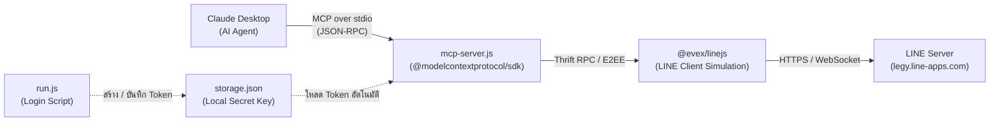

# line-selfbot-mcp

[](https://nodejs.org/)
[](https://github.com/modelcontextprotocol)
[](LICENSE)

**LINE SelfBot MCP Server สำหรับ Claude Desktop**  
ควบคุมและเชื่อมต่อบัญชี LINE ส่วนตัวเข้ากับ AI Agent โดยตรงผ่านไลบรารี [`@evex/linejs`](https://github.com/evex-dev/linejs) รองรับการอ่านและส่งข้อความ แชทเดี่ยว (1-on-1) แชทกลุ่ม และดึง/ส่งรูปภาพแบบเข้ารหัส End-to-End Encryption (E2EE) โดยไม่ต้องเปิดหน้าต่างโปรแกรม LINE Desktop

---

## 🏛️ สถาปัตยกรรมระบบ (Architecture)



| องค์ประกอบ | หน้าที่ |
|---|---|
| `@evex/linejs` | ไลบรารีจำลอง Client ของ LINE เชื่อมต่อเซิร์ฟเวอร์ LINE โดยตรง รองรับ E2EE |
| `run.js` | สคริปต์สแกน QR Code ครั้งแรกเพื่อรับ AuthToken และเก็บลง `storage.json` |
| `mcp-server.js` | MCP Server ให้บริการ Tools ผ่าน Stdio แก่ Claude Desktop |
| `storage.json` | เก็บ AuthToken, RefreshToken, Certificate และ Private Key **(ห้ามแชร์เด็ดขาด)** |
| `manifest.json` | การตั้งค่าสำหรับแพ็กเกจเป็น Desktop Extension (`.mcpb`) |

---

## ✨ ความสามารถหลัก (Features)

- 💬 **อ่านและสรุปแชท**: ดึงรายการห้องแชทล่าสุด (`list_chats`) ทั้งแชทส่วนตัวและกลุ่ม พร้อมนับข้อความที่ยังไม่อ่าน
- 📜 **ดูประวัติบทสนทนา**: ดึงข้อความย้อนหลัง (`get_chat_messages`) ระบุผู้ส่งและเวลาชัดเจน
- 🖼️ **รองรับรูปภาพ (Vision)**: ดึงรูปภาพจากแชท (`get_message_image`) แปลงเป็น Base64 Image Block ให้ Claude วิเคราะห์และตอบคำถามเกี่ยวกับรูปได้โดยตรง
- ✉️ **ส่งข้อความ**: ส่งข้อความตอบกลับหรือแจ้งเตือนเข้าแชท (`send_message`)
- 📤 **ส่งรูปภาพ E2EE**: ส่งไฟล์รูปภาพจากเครื่องหรือรูปภาพจาก URL ไปยังแชทบุคคล/กลุ่ม (`send_image`)
- ⚡ **Headless & ไม่แย่งเมาส์**: ทำงานเบื้องหลัง ไม่ต้องเปิดโปรแกรม LINE Desktop และไม่รบกวนหน้าจอผู้ใช้

---

## 📋 ความต้องการของระบบ (Prerequisites)

- **OS**: Windows 10/11, macOS หรือ Linux
- **Node.js**: เวอร์ชัน 22 ขึ้นไป (ทดสอบแล้วบน v22 และ v24)
- **Claude Desktop**: เวอร์ชันล่าสุด
- **สมาร์ตโฟน**: ติดตั้งแอป LINE พร้อมล็อกอินบัญชีที่ต้องการเชื่อมต่อ (ใช้สแกน QR และยืนยัน PIN 4 หลัก)

---

## 🚀 วิธีติดตั้งและเริ่มต้นใช้งาน (Quick Start)

### 1. โคลนและติดตั้ง Dependencies

```bash
git clone https://github.com/um1981/line-selfbot-mcp.git
cd line-selfbot-mcp
npm install
```

> **หมายเหตุ:** โปรเจกต์มีไฟล์ `.npmrc` เพื่อชี้ JSR registry (`@jsr:registry=https://npm.jsr.io`) จึงสามารถรัน `npm install` ได้ทันที

### 2. ล็อกอินเข้าสู่ระบบ LINE (ทำครั้งแรกเพียงครั้งเดียว)

รันคำสั่งล็อกอินผ่าน Terminal:

```bash
npm run login
# หรือ node run.js
```

1. หน้าจอ Terminal จะแสดงภาพ **QR Code**
2. เปิดแอป LINE บนมือถือ เข้าฟังก์ชันสแกน QR Code
3. กรอกรหัส **PIN 4 หลัก** ที่แสดงบนหน้าจอ Terminal ลงในมือถือเพื่อยืนยัน
4. เมื่อสำเร็จ ระบบจะบันทึก Token ลงใน `storage.json` ภายในโฟลเดอร์โปรเจกต์โดยอัตโนมัติ

### 3. ตั้งค่าใน Claude Desktop

เปิดไฟล์ตั้งค่า MCP ของ Claude Desktop:
- **Windows**: `%APPDATA%\Claude\claude_desktop_config.json`
- **macOS**: `~/Library/Application Support/Claude/claude_desktop_config.json`

เพิ่มบล็อก `LINE-SelfBot` ในส่วน `mcpServers` (ระบุ Path ให้ตรงกับโฟลเดอร์ในเครื่องของคุณ):

```json
{
  "mcpServers": {
    "LINE-SelfBot": {
      "command": "node",
      "args": [
        "C:\\Users\\<Username>\\path\\to\\line-selfbot-mcp\\mcp-server.js"
      ],
      "cwd": "C:\\Users\\<Username>\\path\\to\\line-selfbot-mcp"
    }
  }
}
```

> ⚠️ **สำคัญมาก:** ต้องระบุ `"cwd"` ชี้มายังโฟลเดอร์โปรเจกต์เสมอ เพื่อป้องกันปัญหา Permission (`EPERM`) เมื่อ Claude เริ่มกระบวนการจากไดเรกทอรีระบบ

บันทึกไฟล์แล้วปิดและเปิดโปรแกรม **Claude Desktop** ใหม่อีกครั้ง

---

## 🛠️ รายการ Tools ที่เปิดให้ Claude ใช้งาน

| Tool Name | Parameters | คำอธิบาย |
|---|---|---|
| `list_chats` | `limit` *(number, ค่าเริ่มต้น 30)* | ดึงรายชื่อแชทล่าสุดทั้งหมด (ทั้ง 1-on-1 และห้องกลุ่ม) เรียงตามเวลาสนทนาล่าสุด |
| `get_chat_messages` | `chatMid` *(string)*, `limit` *(number, ค่าเริ่มต้น 20)* | อ่านประวัติข้อความล่าสุดในแชท หากพบรูปภาพจะแสดง messageId กำกับ |
| `get_message_image` | `chatMid` *(string)*, `messageId` *(string)* | ดึงไบนารีรูปภาพจากข้อความ ส่งกลับให้ Claude วิเคราะห์ด้วยสายตา AI |
| `send_message` | `chatMid` *(string)*, `message` *(string)* | ส่งข้อความตัวอักษรไปยังผู้รับหรือห้องแชท |
| `send_image` | `chatMid` *(string)*, `filePath` *(string)* หรือ `imageUrl` *(string)* | ส่งรูปภาพ (ไฟล์ในเครื่อง หรือ URL) เข้ารหัสแบบ E2EE ส่งไปยังแชท |

### 💡 ตัวอย่างคำสั่งที่สามารถสั่ง Claude

- *"ช่วยดูรายชื่อแชท LINE ล่าสุดหน่อยว่ามีข้อความใหม่อะไรบ้าง"*
- *"อ่านข้อความล่าสุด 10 ข้อความในกลุ่ม 'Dev Team' แล้วสรุปประเด็นสำคัญให้หน่อย"*
- *"ในแชทนี้มีรูปภาพส่งมา ช่วยดึงรูปมาดูแล้วอธิบายว่าคืออะไร"*
- *"ส่งสรุปการประชุมนี้เข้าแชทกลุ่ม MID: c1234567890..."*
- *"ส่งรูปกราฟิกสรุป `C:\reports\daily.png` เข้ากลุ่ม LINE หน่อย"*

---

## 📦 การแพ็กเป็น Desktop Extension (`.mcpb`)

หากต้องการติดตั้งผ่าน UI ของ Claude Desktop (Settings → Extensions) สามารถแพ็กเป็นไฟล์เดียวได้:

```bash
npx @anthropic-ai/mcpb pack
```

จะได้ไฟล์ `line-selfbot-mcp.mcpb` ดับเบิลคลิกเพื่อติดตั้งได้ทันที  
*(หมายเหตุ: หลังจากติดตั้ง ผู้ใช้ยังคงต้องรัน `run.js` เพื่อล็อกอินและสร้าง `storage.json` ครั้งแรก)*

---

## ⚠️ ความปลอดภัยและข้อควรระวัง (Security & Disclaimer)

1. **ห้ามเปิดเผย `storage.json` เด็ดขาด:**  
   ไฟล์ `storage.json` เก็บ AuthToken, Certificate และ Private Key ที่สามารถเข้าถึงบัญชี LINE ของคุณได้เต็มรูปแบบ **ห้าม commit ขึ้น GitHub และห้ามแชร์ให้ผู้อื่น** (โปรเจกต์นี้มี `.gitignore` ป้องกันไว้แล้ว)
2. **ข้อกำหนดการใช้งาน (Terms of Service):**  
   การใช้ SelfBot ขัดต่อเงื่อนไขการให้บริการของ LINE และมีความเสี่ยงที่บัญชีอาจถูกระงับ (Ban) หากส่งข้อความถี่หรือมีพฤติกรรมผิดปกติ **แนะนำให้ใช้บัญชีสำรองสำหรับการพัฒนา/ทดสอบ**
3. **การส่งข้อความอัตโนมัติ:**  
   Claude จะส่งข้อความในนามของบัญชีจริงของคุณทันทีที่เรียกใช้ `send_message` หากต้องการความรัดกุม สามารถเพิ่มคำสั่งใน System Prompt ของคุณให้ Claude ขอยืนยันข้อความก่อนส่งเสมอ

---

## 📚 เอกสารเพิ่มเติม

- [คู่มือขั้นตอนและเบื้องหลังเชิงลึก (SOLUTION_GUIDE.md)](docs/SOLUTION_GUIDE.md)
- [LINEJS Documentation](https://linejs.evex.land)
- [Model Context Protocol (MCP) SDK](https://github.com/modelcontextprotocol/typescript-sdk)

---

## 📄 License

MIT License © 2026 [um1981](https://github.com/um1981)
