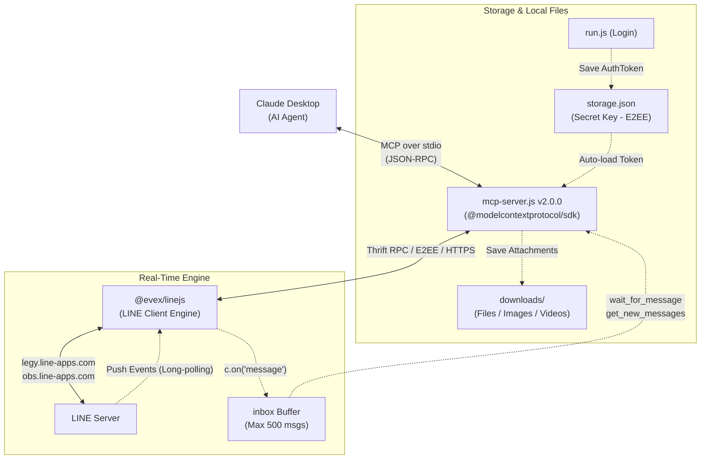

# line-selfbot-mcp

**English** | [ภาษาไทย](README-th.md)

[](package.json)
[](https://nodejs.org/)
[](https://github.com/modelcontextprotocol)
[](#-available-mcp-tools-14-tools)
[](LICENSE)

**LINE SelfBot MCP Server for Claude Desktop (v2.0.0 - 14 Tools)**  
Connect and control personal LINE accounts directly from AI Agents using the [`@evex/linejs`](https://github.com/evex-dev/linejs) library. Enables Claude Desktop to read, send, and receive messages, images, and files with End-to-End Encryption (E2EE), manage contacts/profiles, and listen for incoming messages in real-time—all headless without needing the LINE Desktop GUI application open.

---

## 🏛️ System Architecture

<p align="center">
  
</p>

> 💡 **Original Diagram Assets:** View the interactive HTML version at [`assets/line-selfbot-architecture.html`](assets/line-selfbot-architecture.html) or download the editable draw.io diagram at [`assets/line-selfbot-architecture.drawio`](assets/line-selfbot-architecture.drawio).

<details>
<summary>Show Mermaid Topology (Text Fallback)</summary>



</details>

| Component | Responsibility |
|---|---|
| `@evex/linejs` | LINE Client simulation engine connecting directly to LINE backend via Thrift RPC with E2EE and long-polling |
| `run.js` | One-time interactive terminal script to scan QR code, authenticate with PIN, and persist `storage.json` |
| `mcp-server.js` | Fast, lightweight MCP server hosting 14 tools over Stdio JSON-RPC protocol |
| `storage.json` | Stores AuthToken, RefreshToken, Certificate, and E2EE Private Keys **(Strictly Confidential - Never Share)** |
| `downloads/` | Dedicated local directory for attachments and media downloaded from LINE |
| `manifest.json` | Extension definition for 1-click installation via Anthropic Desktop Extension (`.mcpb`) |

---

## ✨ Key Features

- 💬 **Read & Summarize Chats**: Fetch recent chats (`list_chats`) for both 1-on-1 private conversations and group chats, with contact names and unread counts.
- 📜 **Message History**: Retrieve historical messages (`get_chat_messages`) with sender display names (`fromName`), timestamps, and media indicators.
- 🖼️ **Multimodal Vision Support**: Extract image attachments (`get_message_image`) as Base64 image content blocks so Claude can visually inspect and analyze pictures.
- 📥 **Attachment Downloads**: Download files, PDF documents, videos, and audio clips (`download_message_file`) directly to the `downloads/` directory.
- ✉️ **Send Messages & Photos**: Send text messages (`send_message`) and E2EE encrypted images (`send_image`) from local paths or remote URLs.
- 📎 **Send Any File Type**: Upload documents (PDF, Word, Excel, ZIP), videos (MP4), and audio (MP3) seamlessly with automatic MIME type resolution (`send_file`).
- 👥 **Contacts & Group Management**: Search friends list (`list_friends`), inspect group members and creators (`list_group_members`), or set custom friend nicknames (`rename_friend`).
- 👤 **Profile Controls**: Inspect account profile (`get_my_profile`) or update your display name and status message (`update_my_profile`).
- ⚡ **Real-Time Push Inbox**: Wait synchronously for incoming messages (`wait_for_message`) or query newly received messages from the real-time buffer (`get_new_messages`).

---

## 📋 Prerequisites

- **Operating System**: Windows 10/11, macOS, or Linux
- **Node.js**: Version 22 or higher (tested on v22 and v24)
- **Claude Desktop**: Latest release
- **Mobile Device**: Smartphone running the official LINE app logged in to your account (required for QR scan and 4-digit PIN confirmation)

---

## 🚀 Quick Start Guide

### 1. Clone Repository & Install Dependencies

```bash
git clone https://github.com/um1981/line-selfbot-mcp.git
cd line-selfbot-mcp
npm install
```

> **Note:** The project includes a configured `.npmrc` pointing to the JSR registry (`@jsr:registry=https://npm.jsr.io`), allowing standard `npm install` to resolve `@evex/linejs` automatically.

### 2. Authenticate with LINE (First-time only)

Run the login script in your terminal:

```bash
npm run login
# or: node run.js
```

1. A **QR Code** will appear directly in your terminal.
2. Open the LINE app on your smartphone and scan the terminal QR code.
3. Enter the **4-digit PIN code** shown on your terminal into your smartphone to authorize the login.
4. Once completed, your session credentials will be saved automatically to `storage.json`.

### 3. Configure Claude Desktop

Open your Claude Desktop configuration file:
- **Windows**: `%APPDATA%\Claude\claude_desktop_config.json`
- **macOS**: `~/Library/Application Support/Claude/claude_desktop_config.json`

Add the `LINE-SelfBot` entry under `mcpServers` (replace the paths with your exact local project directory):

```json
{
  "mcpServers": {
    "LINE-SelfBot": {
      "command": "node",
      "args": [
        "C:\\Users\\<Username>\\path\\to\\line-selfbot-mcp\\mcp-server.js"
      ],
      "cwd": "C:\\Users\\<Username>\\path\\to\\line-selfbot-mcp"
    }
  }
}
```

> ⚠️ **Important:** Always provide the `"cwd"` property pointing to your project directory. This avoids file permission errors (`EPERM`) caused by Claude Desktop launching processes from `C:\Windows\System32` on Windows.

Restart **Claude Desktop** to load the new MCP server.

---

## 🛠️ Available MCP Tools (14 Tools)

### 👤 Profile Management
| Tool | Parameters | Description |
|---|---|---|
| `get_my_profile` | – | View personal profile information (display name, MID, status message, LINE user ID). |
| `update_my_profile` | `displayName` *(≤20 chars)*, `statusMessage` *(≤500 chars)* | Update your account display name and/or status message. |
| `rename_friend` | `userMid`, `newName` | Override a friend's display name locally in your contact list (pass `""` to reset). |

### 👥 Contacts & Groups
| Tool | Parameters | Description |
|---|---|---|
| `list_chats` | `limit` *(default 30)* | List recent 1-on-1 and group chats ordered by latest conversation. |
| `list_friends` | `search` *(optional string)* | Retrieve all friends from contact list with MID and status message. |
| `list_group_members` | `chatMid` *(`c...`)* | Get all members, creator (`isCreator`), and pending invitees of a group chat. |

### 📖 Reading & Downloading
| Tool | Parameters | Description |
|---|---|---|
| `get_chat_messages` | `chatMid`, `limit` *(default 20)* | Read recent messages with sender name (`fromName`), timestamp, and attachment metadata. |
| `get_message_image` | `chatMid`, `messageId` | Fetch raw image data as Base64 for Claude vision analysis. |
| `download_message_file` | `chatMid`, `messageId`, `saveDir` *(optional)* | Download attachments (PDF, documents, videos, audio) to local disk (default: `downloads/`). |

### 📤 Sending Messages & Files
| Tool | Parameters | Description |
|---|---|---|
| `send_message` | `chatMid`, `message` | Send a plain text message to a recipient or group. |
| `send_image` | `chatMid`, `filePath` or `imageUrl` | Send an image (JPEG, PNG, GIF, WebP) with E2EE encryption. |
| `send_file` | `chatMid`, `filePath` or `fileUrl`, `fileName` *(optional)* | Send documents (PDF, DOCX, XLSX, ZIP), video (MP4), or audio (MP3) with E2EE. |

### ⚡ Real-Time Push & Polling
| Tool | Parameters | Description |
|---|---|---|
| `wait_for_message` | `chatMid` *(optional)*, `timeoutSec` *(max 50)* | Block and wait for incoming real-time push messages (up to 50 seconds). |
| `get_new_messages` | `chatMid` *(optional)*, `clear` *(default true)* | Query unread messages accumulated in the memory buffer since listener started. |

---

## 💡 Example Prompt Ideas

- *"Check my recent LINE chats and summarize any unread conversations."*
- *"Find all friends in my contact list whose name contains 'Alex'."*
- *"Who is currently in the 'Engineering Team' group, and who created it?"*
- *"Read the last 15 messages in the project group and summarize the discussion."*
- *"An image was just sent in my chat with Sarah—pull the image and describe what it shows."*
- *"Download the latest PDF report sent in the Finance room and summarize its contents."*
- *"Send the sales report file at `C:\reports\q3_summary.xlsx` to Michael."*
- *"Send 'Are you available for a quick sync?' to John, wait for his reply, and notify me."*
- *"Update my LINE status message to 'Traveling - Available on Slack'."*

---

## 📦 Packaging as Desktop Extension (`.mcpb`)

For 1-click installation via Claude Desktop GUI (Settings → Extensions):

```bash
npx @anthropic-ai/mcpb pack
```

This compiles a standalone `line-selfbot-mcp.mcpb` file. Double-click the file to install it.  
*(Note: You will still need to run `run.js` once inside the installation folder to establish your initial login session).*

---

## ⚠️ Security & Disclaimer

1. **Protect `storage.json` at all costs:**  
   The `storage.json` file contains your active AuthToken, Certificates, and E2EE private keys. It grants complete access to your LINE account. **Never commit this file to GitHub and never share it publicly** (the repository `.gitignore` is already configured to protect it).
2. **LINE Terms of Service:**  
   Using a SelfBot is against LINE Corporation's Official Terms of Service. Unnatural messaging frequency or rapid re-logins can lead to account suspension. **Always use a secondary/test LINE account for development.**
3. **Automated Actions:**  
   When instructed, Claude will send messages and update profiles immediately under your actual identity. For safety, you may instruct Claude in your system prompt to require explicit user confirmation before executing `send_message` or `send_file`.
4. **File Safety:**  
   Files downloaded via `download_message_file` are written directly to disk. Exercise caution when opening attachments received from unknown contacts.

---

## 📜 Version History

| Version | Highlights |
|---|---|
| **v1.0 – v1.2** | Basic support for `list_chats`, `send_message`, `get_chat_messages` (group only). |
| **v1.3** | Added 1-on-1 direct message support via `getMessageBoxes` and `getRecentMessagesV2`. |
| **v1.4** | Added `get_message_image` enabling Claude vision capabilities. |
| **v1.5** | Added `send_image` supporting local files and image URLs with E2EE. |
| **v1.6** | Added `list_friends` contact directory lookup. |
| **v1.7** | Added `list_group_members`, sender display name resolution (`fromName`), and batch `resolveNames()`. |
| **v1.8** | Added real-time push architecture: `wait_for_message` and `get_new_messages` with 500-item inbox buffer. |
| **v1.9** | Added `send_file`, `download_message_file`, `loadMedia()` utility, and `MIME_MAP` parser. |
| **v2.0.0** | Full suite of 14 tools including `get_my_profile`, `update_my_profile`, and `rename_friend`. |

---

## 📚 References & Resources

- [Comprehensive Thai Solution Guide (SOLUTION_GUIDE.md)](docs/SOLUTION_GUIDE.md)
- [LINEJS GitHub Repository](https://github.com/evex-dev/linejs)
- [LINEJS Official Documentation](https://linejs.evex.land)
- [Model Context Protocol (MCP) TypeScript SDK](https://github.com/modelcontextprotocol/typescript-sdk)
- [Anthropic MCPB Extension Packager](https://github.com/anthropics/mcpb)

---

## 📄 License

MIT License © 2026 [um1981](https://github.com/um1981)
